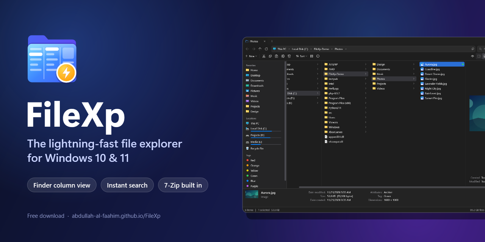
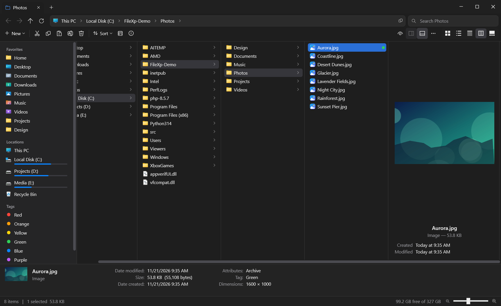
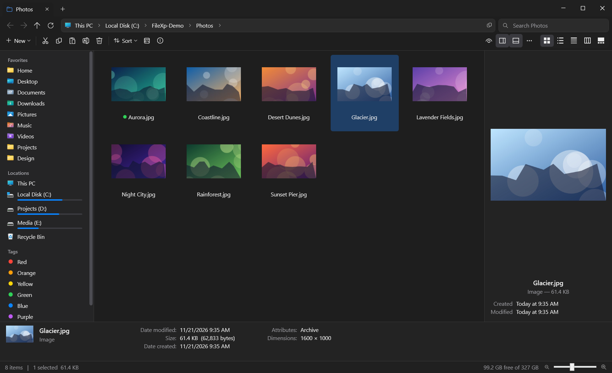
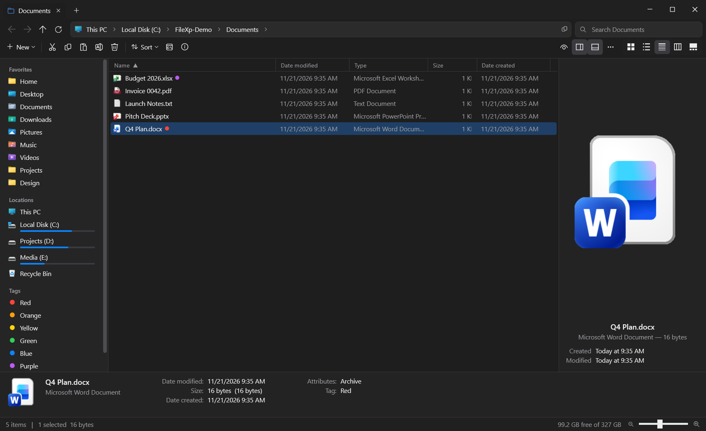
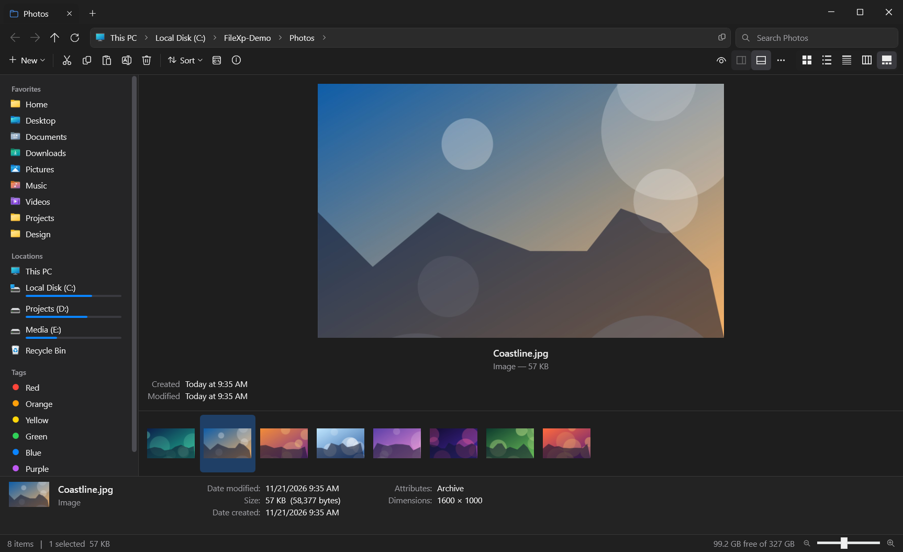

  

  
  &nbsp;
  

  <a href="https://abdullah-al-faahim.github.io/FileXp/"><b>Website</b></a> ·
  <a href="https://github.com/abdullah-al-faahim/FileXp/releases/latest">All downloads</a> ·
  <a href="https://apps.microsoft.com/detail/9NHB2MKLL81Q?mode=direct">Microsoft Store</a> ·
  <a href="#features">Features</a> ·
  <a href="https://github.com/abdullah-al-faahim/FileXp/issues">Report an issue</a>

  
  
  

**FileXp** is a fast, native file explorer for Windows 10 and 11. It brings macOS Finder's column and gallery views and the Windows 7 details pane to a modern Windows app. It also adds instant search across every file on your PC and built-in 7-Zip support. Everything runs through the real Windows shell, so copying, context menus, thumbnails and the Recycle Bin behave exactly like File Explorer. FileXp is free.

- **Installer:** [`FileXp-Setup.exe`](https://github.com/abdullah-al-faahim/FileXp/releases/latest/download/FileXp-Setup.exe) (about 43 MB). It installs for your user account only, with no admin rights needed.
- **Portable:** a zip on the [releases page](https://github.com/abdullah-al-faahim/FileXp/releases/latest) that runs from any folder or USB stick and keeps its settings next to the exe.
- **Microsoft Store:** [FileXP - File Explorer](https://apps.microsoft.com/detail/9NHB2MKLL81Q?mode=direct) installs and updates automatically. The Store version can't become your default file explorer, because Windows doesn't allow Store apps to change that; use the installer for that.

> FileXp isn't code-signed yet, so Windows SmartScreen may show "Windows protected your PC". Click **More info → Run anyway**.

---

## Screenshots

| Finder column view | Icons with live thumbnails |
|---|---|
|  |  |
| **Details view and Windows 7 details pane** | **Gallery view** |
|  |  |

## Features

### Views (Ctrl+1…5)
- **Columns**: Finder-style Miller columns showing the full path from This PC, with a preview column for the selected file. Use ←/→ to move between columns, and drag a column's edge to resize it (hold Alt to resize all).
- **Icons**: a virtualized grid with live thumbnails for images, video, PDF and Office files. Use Ctrl+mouse wheel or the slider to set the size (32–256 px).
- **Details**: sortable name, date, type and size columns. The columns adapt for search results, the Recycle Bin and This PC.
- **List** and **Gallery**: a compact list, or a large preview above a strip of thumbnails.

### Panes
- **Details pane** at the bottom, Windows 7 style:
  - type, exact size in bytes, dates and attributes
  - image dimensions and shortcut targets
  - folder size and contents, calculated in the background
  - drive capacity, and totals for multi-selections
- **Preview pane**: images, text and code, audio and video with playback controls, and shell thumbnails for everything else.
- **Quick Look**: press Space for a full-size preview, and use the arrow keys to move through files.

### Instant search
FileXp builds its own index of every file on your fixed drives. No add-ons are needed.
- Searching 1.8 million files usually takes **2–10 ms**, and a single search can return up to **1,000,000 results**.
- Search the whole PC from This PC, or just the folder you're in.
- Query syntax: `words` (all must match), `"exact phrase"`, `*.pdf` or `report?`, and `ext:pdf` or `ext:jpg;png`.
- The index stays current while FileXp runs. Network shares and USB drives fall back to a streaming folder scan.

### File management
- Copy, move, delete and recycle run through the Windows shell. You get the native progress and conflict dialogs, Undo, long paths and network shares, and the window never freezes.
- Drag and drop works in and out, onto folders, tabs, the sidebar and breadcrumbs. Ctrl copies, Shift moves and Alt creates a shortcut.
- The clipboard works with File Explorer in both directions. Paste an image or text to save it as a file.
- Create new folders, files and shortcuts, rename, and batch rename (`Name (1)…` or `old => new`).
- **Archives**, powered by 7-Zip when it's installed:
  - Extract to a folder or extract here. Supported formats include 7z, zip, rar, tar.gz/xz/bz2, iso and cab.
  - Add to .7z or .zip, test an archive, or open it in 7-Zip.
  - Password-protected archives prompt for the password.
- **Recycle Bin**: browse, restore, delete permanently and empty.
- The full **native Windows context menu** is available (Shift+right-click or "Show more options").
- Finder-style **colour tags**, pinned folders, tabs and multiple windows.

### Navigation
- Breadcrumbs with Windows 7 chevron menus. Click the empty part of the bar to type a path, with autocomplete.
- Back and forward history menus, plus the mouse back and forward buttons.
- A sidebar with favourites, drives with capacity bars (USB drives appear live), the Recycle Bin and tags.
- Light and dark themes follow Windows, and the tab bar doubles as the title bar.

### Make it your default file explorer
Open **⋯ → Settings → Make FileXp the default**. Folders, drives, **Win+E** and This PC then open in FileXp. The change applies to your user account only and needs no admin rights. **Restore Windows Explorer** undoes it, and so does uninstalling FileXp.

## Speed

| On a PC with 1,771,955 files | |
|---|---|
| Full search index built | 14 s, in the background |
| Index loaded on later launches | 50 ms |
| Typical search across all drives | 2.5–10 ms |
| Index memory | about 84 MB |
| Opening a folder when FileXp is already running | about 0.4 s (handed to the running app) |

- **Folder listing:** folders are listed with raw `NtQueryDirectoryFile` entries, and every view is virtualized, so a folder with 100,000 files only creates the rows you can see.
- **Icons and thumbnails:** icons are cached per file type. Thumbnails load on background threads, newest request first.
- **Search index:** names are stored in one flat UTF-8 buffer, so a search is a single vectorized byte scan split across all cores.

## Keyboard shortcuts

| Keys | Action |
|---|---|
| Ctrl+1…5 | Icons / List / Details / Columns / Gallery |
| Space | Quick Look |
| Enter, Ctrl+Enter | Open, open in a new tab |
| Alt+←/→/↑, Backspace | Back / Forward / Up |
| Ctrl+L, Alt+D, F4 | Edit the address |
| Ctrl+F, F3 | Search |
| F2 | Rename (with several items selected: batch rename) |
| Del, Shift+Del | Recycle, delete permanently |
| Ctrl+Shift+N | New folder |
| Ctrl+Shift+C | Copy path |
| Ctrl+H | Show or hide hidden items |
| Alt+P, Alt+Shift+P | Preview pane, details pane |
| Alt+Enter | Properties |

Press **F1** in the app for the full list.

## Feedback

Found a bug or have an idea? [Open an issue](https://github.com/abdullah-al-faahim/FileXp/issues). Please include your Windows version and the steps to reproduce.

© 2026 abdullah-al-faahim. FileXp is free to download and use.
